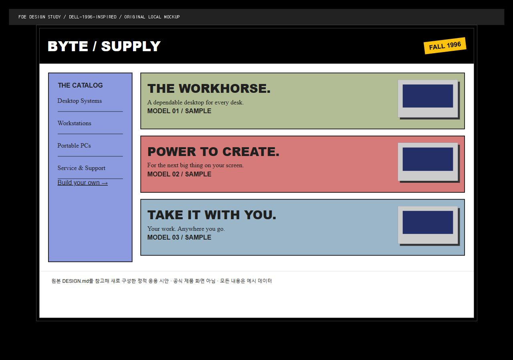

# Dell 1996 · 레트로 카탈로그

검정 프레임과 평면 색띠. 적합한 용도: 제품 카탈로그·개성 있는 포트폴리오.

## 화면의 출처

MD 기반 신규 시안. 공식 서비스 화면이 아니라 디자인 분석에 따른 재현 또는 응용 시안이다. 한국 자료는 원본 구역을 발췌하고 스크립트를 제거했으며 로컬 에셋 경로로 바꿨다. 해외 시안은 원본 MD의 색·타이포·구성을 참고해 이 키트에서 새로 작성했다. 정적 예시의 버튼은 제품 기능이 아니다.



[화면 열기](screen.html) · [원본 MD](DESIGN.md) · [원본 사이트](https://getdesign.md/dell-1996/design-md) · [GitHub 원본](https://github.com/VoltAgent/awesome-design-md/blob/main/design-md/dell-1996/DESIGN.md)

## 적용 기준

- 이 화면의 주 작업을 먼저 정하고 레이아웃·밀도·탐색 방식까지 함께 반영한다.
- 브랜드의 로고·상표·전용 폰트와 더미 문구를 실제 제품 자산으로 복사하지 않는다.
- 한국어 본문 가독성과 키보드 포커스, 빈 값·오류·로딩 상태를 추가한다.
- 원본 MD의 Known Gaps와 추정값을 확인한다. 미리보기는 접근성 합격 증거가 아니다.
- 정적 프리뷰의 작동하지 않는 버튼을 완성 기능으로 설명하지 않는다.

## 출처와 변경 표시

MIT · VoltAgent; 응용 시안은 이 키트에서 작성. 확인일 2026-10-26. 한국 자료의 저작자 표시는 ko-design-md by ChangSik Yoon (https://github.com/CaesiumY/ko-design-md), CC BY 4.0. LICENSE-CONTENT와 NOTICE의 제외 항목도 함께 확인한다. 원문 MD는 수정하지 않았다.

## 적용 프롬프트

```text
design-library/COMMON_RULES.md와 design-library/screens/dell-1996/DESIGN.md, design-library/screens/dell-1996/APPLY.md를 읽고 화면을 만들어줘. screen.html과 screenshot.png는 정보 구조와 시각적 리듬을 확인하는 참고 자료야. 색만 바꾸지 말고 검정 프레임과 평면 색띠을 사용자 작업에 맞게 반영해줘. 원 브랜드명·로고·제품 문구는 복제하지 마. 기존 기능을 유지하고 변경 전 백업, 실제 데이터 상태와 모바일 검증, 결과 캡처까지 해줘.
```
